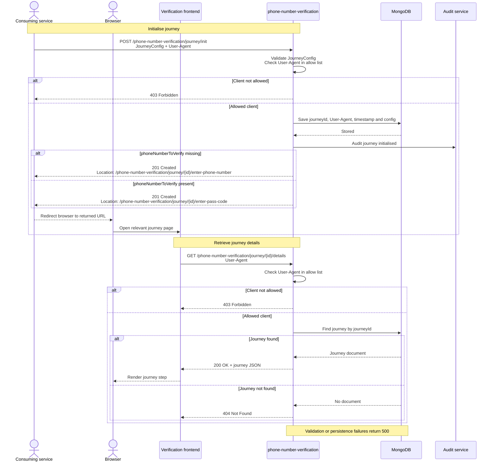

## phone-number-verification

### Summary

This service provides the backend capability for verifying a UK phone number as part of a consumer-facing journey and also as a direct API. It is used by frontends or directly via a REST API that need to confirm a user owns a phone number before allowing 
them to continue through a service.

The service supports two main styles of integration:

- A journey-based flow for browser-driven frontends, where a frontend starts a verification journey, receives the next step URL, and then continues the user through a phone number entry or passcode entry screen.
- Direct API endpoints for sending an SMS code to a phone number and verifying the code entered by the user.

In the journey-based flow, a consuming frontend calls `/journey/init` with the journey configuration and receives a redirect URL for the next step in the flow. This service stores the configuration and returns the next page to continue the user journey,
such as entering a phone number or entering the verification code.

- `POST /journey/init` to start a new phone number frontend verification journey

In the direct API flow, a frontend or other service can call the following endpoints:

- `POST /phone-number-verification/send-code` to send an SMS verification code to a provided phone number
- `POST /phone-number-verification/verify-code` to check that the code entered by the user matches the one sent for that number

Together these capabilities let a frontend/service verify a user’s phone number during another service’s journey.

### Journey integration sequence

### POST /journey/init

This endpoint is used by a consuming frontend to start a phone number verification journey before handing the user off to the phone number verification frontend screens.

Include a `User-Agent` HTTP header with the consuming service's name. This must be the same name that was added to the allow list when the service onboarded.

Use this endpoint when your service wants to begin a verification flow and provide the journey configuration, including:

- a `credentialId` identifying the user in your service.
- the `options` for the journey, such as URLs for service, sign-out, accessibility statement, and completion
- optional `labels` for page text
- optional `phoneNumberToVerify` if the consumer already knows the number to verify

Example request:

    POST /phone-number-verification/journey/init
    Content-Type: application/json
    User-Agent: the-actual-consuming-service-name

    {
      "credentialId": "my-credential-id",
      "options": {
        "serviceUrl": "https://example.service.gov.uk",
        "signOutUrl": "https://example.service.gov.uk/sign-out",
        "accessibilityStatementUrl": "https://example.service.gov.uk/accessibility-statement",
        "completionUrl": "https://example.service.gov.uk/complete",
        "displayHmrcBanner": true,
        "displayPhaseBanner": "beta",
        "isWelshEnabled": true,
        "isBackLinkEnabled": true
      },
      "labels": {
        "en": {
          "pageTitle": "Verify your phone number"
        }
      },
      "phoneNumberToVerify": "+447700900123"
    }

The service validates the request, creates a new `journeyId`, stores the configuration in Mongo and responds with the next URL the consumer should redirect to.

Example response:

    201 Created
    Location: /phone-number-verification/journey/2e0d3db2-9f17-4f34-8d76-8e25a0f4a2c7/enter-pass-code

The service responds with a `201 Created` status and a `Location` header containing the next journey URL. The frontend should redirect the user to that URL.

This controls the next page in the journey:

- if `phoneNumberToVerify` is not supplied, the next step is usually `/journey/{journeyId}/enter-phone-number`
- if `phoneNumberToVerify` is supplied, the next step is usually `/journey/{journeyId}/enter-pass-code`

This lets the consuming service kick off the verification journey without needing to manage the SMS code lifecycle itself.
The service handles the journey state and then the frontend continues the user through the relevant screens.

### GET /journey/{journeyId}/details

This endpoint is used by the phone number frontend to retrieve the journey configuration for a given `journeyId`. The frontend can use this information to render the appropriate screens and handle the journey flow.

Example request:

    GET /phone-number-verification/journey/2e0d3db2-9f17-4f34-8d76-8e25a0f4a2c7/details
    User-Agent: phone-number-verification-frontend

Example response:

    200 OK
    {
        "journeyId": "2e0d3db2-9f17-4f34-8d76-8e25a0f4a2c7",
        "journeyCreatedAt": "2026-10-16T12:34:56Z",
        "journeyUserAgent": "the-actual-consuming-service-name",
        "journeyConfig": {
            "credentialId": "my-credential-id",
            "options": {
                "serviceUrl": "https://example.service.gov.uk",
                "signOutUrl": "https://example.service.gov.uk/sign-out",
                "accessibilityStatementUrl": "https://example.service.gov.uk/accessibility-statement",
                "completionUrl": "https://example.service.gov.uk/complete",
                "displayHmrcBanner": true,
                "displayPhaseBanner": "beta",
                "isWelshEnabled": true,
                "isBackLinkEnabled": true
            },
            "labels": {
                "en": {
                    "pageTitle": "Verify your phone number"
                }
            },
            "phoneNumberToVerify": "+447700900123"
        }
    }

### Testing

#### Unit tests

    sbt clean test

#### Integration tests

    sbt clean it/test

#### All tests with code coverage

    sbt clean coverage test it/test coverageReport

### Running app

    sm2 --start PHONE_NUMBER_VERIFICATION_ALL

Run the services against the current versions in dev, stop the PHONE_NUMBER_VERIFICATION service and start manually

    sm2 --start PHONE_NUMBER_VERIFICATION_ALL -r
    sm2 --stop PHONE_NUMBER_VERIFICATION
    cd phone-number-verification
    sbt run

For reference here are the details for running each of the services individually

    cd phone-number-frontend
    sbt run
 
    cd phone-number
    sbt run

    cd phone-number-verification
    sbt run

    cd phone-number-stubs
    sbt run

### Curl microservice (for curl microservice build jobs)

#### Send Code

    -XPOST -H "Content-type: application/json" -d '{
	    "phoneNumber": "<phone-number>"
    }' 'https://phone-number-verification.protected.mdtp/phone-number-verification/send-code'

#### Verify Code

    -XPOST -H "Content-type: application/json" -d '{
	    "phoneNumber": "<phone-number>",
        "verificationCode": "<verification-code>"
    }' 'https://phone-number-verification.protected.mdtp/phone-number-verification/verify-code'

#### Test data when using `use-test-phone-number-verification-service = true`

| Endpoint     | Phone Number  | Verification Code | Status              | HTTP Response Code |
|--------------|---------------|-------------------|---------------------|--------------------|
| /send-code   | +447966123123 |                   | CODE_SENT           | 200                |
| /send-code   | 12345         |                   | VALIDATION_ERROR    | 400                |
| /send-code   | +441494123124 |                   | VALIDATION_ERROR    | 400                |
| /verify-code | +447966123123 | ABCDEF            | CODE_VERIFIED       | 200                |
| /verify-code | +447966555666 | ABCDEF            | CODE_VERIFY_FAILURE | 404                |
| /verify-code | +447966123124 | test              | VALIDATION_ERROR    | 400                |

### Test Only endpoints

| Endpoint                         | Description                                      |
|---------------------------------|--------------------------------------------------|
| /test-only/phone-number-attempts/:credentialId       | Delete all attempts for a given credentialId (used in tests to reset state) |

### License

This code is open source software licensed under
the [Apache 2.0 License]("http://www.apache.org/licenses/LICENSE-2.0.html").
